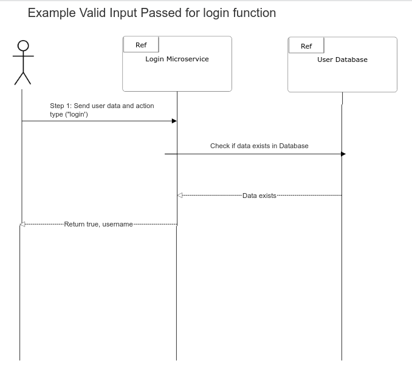

# LOGIN MICROSERVICE

## Program Description

This microservice takes in JSON data through a ZMQ socket message from another program,
then uses that input to either create and add a new user JSON object containing the
input username and encrypted password to a database, or verifies the existence of the given
username and password. Data for this program is passed across local port 5353.

## Sample request and response collection

~~~python
import json
import zmq

#setup socket
context = zmq.Context()
socket = context.socket(zmq.REQ)
socket.connect("tcp://localhost:5353")

#Setup input, then send to socket
input_data = {
    "action": "login", #This would ask for validation of input. To create a new user, write "action": "create"
    "username": "sampleUName",
    "password": 1234567890
}

input_data = json.dumps(input_data, indent=4)

socket.send_json(input_data)

#Wait for return data
output = socket.recv_json()

~~~

## Response Format

### Valid input

~~~json
{
    "success": true,
    "message": "sampleUName"
}
~~~

### Error examples

Validating user, input user does not exist

~~~json
{
    "success": false,
    "message": "ERROR, username does not exist."
}

~~~

Validating user, input password does not match username

~~~json
{
    "success": false,
    "message": "ERROR, incorrect password."
}
~~~

Creating user, input username already exists

~~~json
{
    "success": false,
    "message": "ERROR, username already exists."
}
~~~

## UML Diagram for a Successful Login Attempt

